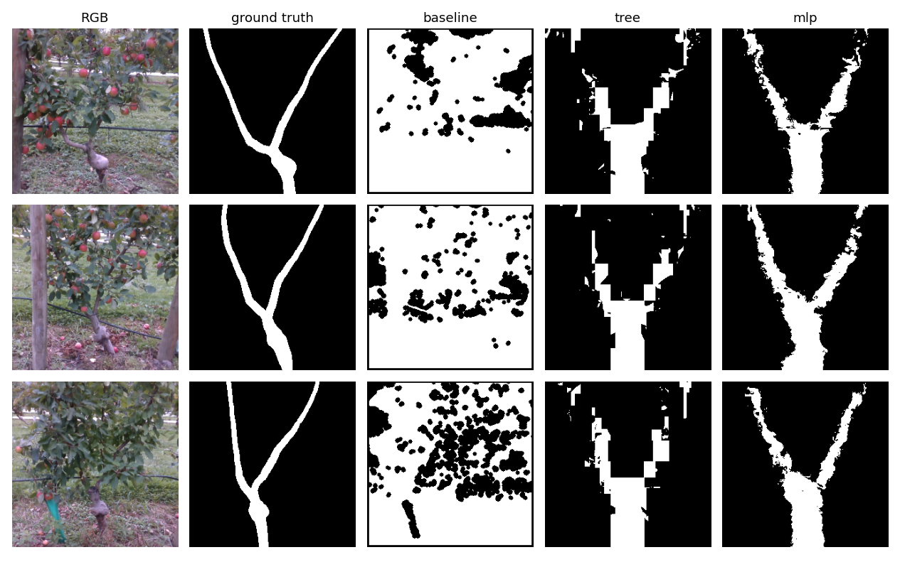

# Apple-tree branch reconstruction (MMA3001 individual project)

**Purpose.** A harvesting robot or orchard drone has to avoid the rigid trunk and branches of a tree, many of which are hidden behind leaves in summer. This project estimates where the trunk and branches are, including hidden ones, from a single summer RGB-D image of a trellised apple tree (TreeID dataset). The output is a 256 x 256 branch mask and its skeleton. Every method is validated against the supplied ground-truth branch masks on trees held out from training.

## Results at a glance

On 81 held-out test trees (`doc/report/results_summary.md`):

| Method | Test Dice | 5-fold CV Dice | Chamfer (px) | Time per image |
|---|---|---|---|---|
| Baseline: colour + depth thresholding | 0.149 | n/a | 20.1 | 0.025 s |
| Shape prior: mean training mask, no image input | 0.377 | 0.379 ± 0.013 | 10.2 | ≈ 0 |
| Decision tree regression (selected) | 0.358 | 0.366 ± 0.007 | 12.0 | 0.002 s |
| MLP regression | 0.369 | 0.373 ± 0.014 | 10.1 | 0.003 s |

The per-pixel regression models more than double the baseline's Dice. They do not beat a fixed mean mask, though, because most of what they learn is where trees usually are in the frame. The ground-truth masks are also offset from the visible trunk by a median of about 15 px. Both findings, the failure cases and all limitations are in `doc/report/results_summary.md`. The U-Net in `src/train_unet.py` is future work: it has not been trained.



## Repository layout

```
.github/workflows/ci.yml  CI: installs requirements.txt, runs the tests and builds the docs on every push
config/default.toml       All settings: data path, season, excluded rows, baseline thresholds, model and evaluation settings
data/                     The dataset goes here; NOT committed (only data/README.md is)
doc/
  api/                    HTML API documentation generated by pdoc (committed)
  report/                 results_summary.md (all numbers and limitations), outline.md
  problem_statement.md    Engineering problem, inputs and outputs (section 2b: as implemented)
  ai_use.md               AI-use log and reflection
  test_report.html        pytest-html test report (committed)
outputs/                  Trained models written by the scripts; NOT committed
res/                      Results written by the scripts: CSV tables and figures (committed)
src/
  main.py                 Baseline over the whole dataset, prints mean metrics
  baseline.py             Colour + depth thresholding baseline and skeletonisation
  dataset.py              File pairing, input checks, split and k-fold by tree, sample loading
  features.py             Per-pixel features for the regression models
  train.py                Main method: regression models vs baseline and shape prior on the test trees
  crossval.py             k-fold cross-validation by tree for model selection
  metrics.py              IoU, Dice, precision/recall, occluded recall, Chamfer distance
  alignment.py            Ground-truth offset estimate (FFT cross-correlation)
  utils.py                Config and image I/O
  unet.py, train_unet.py  U-Net (future work; needs PyTorch)
tests/                    pytest tests on synthetic data (no dataset needed)
tools/                    Scripts for docs, tests, profiling, sensitivity and failure analysis (see below)
```

## Environment

Python 3.10 or newer; CI uses 3.11. Dependency versions are pinned. Local setup:

```bash
python3 -m venv .venv && source .venv/bin/activate     # .venv is gitignored
pip install -r requirements.txt                         # everything except the U-Net
pip install -r requirements-train.txt                   # optional: adds PyTorch for the U-Net code and its tests
```

In Colab:

```python
!git clone https://github.com/kseniacar/apple-tree-reconstruction.git
%cd apple-tree-reconstruction
!pip install -r requirements.txt
from google.colab import drive; drive.mount('/content/drive')
!python src/main.py --data-root /content/drive/MyDrive/TreeID
```

## Data

The TreeID dataset (Chen et al., 2020, arXiv:2010.06879) is too large for GitHub and is **not stored in this repository**. `data/*` is gitignored.

1. Download it from `https://drive.google.com/drive/folders/16qylQXmTf9OiKgKCMliudNYEUYxqlNEr?usp=sharing`.
2. Unzip it so that you have `data/TreeID/Dataset (With Summer GT)/...`, or point `data_root` in `config/default.toml` (or `--data-root`) at wherever it is.

The scripts use the summer images that have a ground-truth mask: 541 images, one per tree. Row R04 is excluded (`exclude_rows` in the config) because its winter depth images are copies of other trees' (the duplicate-depth check in `src/dataset.py` confirms all duplicated depth files are in R04). Images without a depth file are processed RGB-only with a warning.

## Reproducing every result

Run from the repository root with the environment active. Times are measured on an Apple M2 laptop (CPU), except where marked as approximate. Each command writes the files listed, which feed the sections of `doc/report/results_summary.md`.

| Step | Command | Time | Writes | Results summary |
|---|---|---|---|---|
| 1 | `python src/main.py` | 15 s | prints baseline means | quick check |
| 2 | `python src/train.py` | 5 min | `res/ml_results.csv`, `ml_validation.csv`, `gt_offsets.csv`, `ml_results_aligned.csv`, `tree_feature_importance.csv`, `ml_examples.png`, `outputs/*.joblib` | 1, 1b, 1c |
| 3 | `python src/crossval.py` | 55 min (mostly SVR) | `res/cv_folds.csv`, `res/cv_summary.csv` | 1a |
| 4 | `python tools/failure_cases.py` | 1 min (needs step 2) | `res/per_image_scores.csv`, `res/failure_cases.png` | 1d |
| 5 | `python tools/gt_offset.py` | 1 min | `res/gt_offset_sheet_*.png`, summary of `res/gt_offset_manual.csv` | 1c |
| 6 | `python src/train.py --work-size 64 --models tree mlp` (and `--work-size 256`) | a few minutes (256: longer, about 3 GB of features in RAM) | `res/ml_results_ws64.csv` (`_ws256`) | 2 |
| 7 | `python src/train.py --no-depth --models tree mlp` | a few minutes | `res/ml_results_rgb.csv` | 3 |
| 8 | `python src/train.py --no-position --models tree mlp` | a few minutes | `res/ml_results_nopos.csv` | 3b |
| 9 | `python tools/baseline_sensitivity.py` | 1 min | `res/baseline_sensitivity.csv` | 3c |
| 10 | `python tools/profile_baseline.py` | 5 s, no data | prints cProfile table | 4 |
| 11 | `python tools/profile_memory.py` | 5 s, no data | prints memory table | 4b |
| 12 | `python tools/unet_cost.py` | 5 s, no data, needs PyTorch | prints U-Net cost table | 4c |

Add `--limit 40` to any `src/` script for a quick check on 40 images. Everything uses `seed = 0` from the config, so re-running gives the same numbers: the 2026-10-25 re-run of step 2 reproduced the 2026-10-14 accuracy numbers exactly.

**How the main method works.** `src/train.py` gives each pixel colour, depth, excess-green, Gaussian-smoothed neighbourhood (sigma 2 and 6) and row/column features. Linear regression, a decision tree, SVR and an MLP each predict how likely a pixel is to be branch. Images are split by tree into 379 train / 81 validation / 81 test. The validation trees set each model's threshold, and the test trees are used only once, for the final comparison with the baseline and the shape prior.

## Tests and documentation

```bash
bash tools/run_tests.sh     # pytest + HTML report in doc/test_report.html (PyTorch tests skip without PyTorch)
bash tools/build_docs.sh    # pdoc HTML API docs in doc/api/ (U-Net modules included only if PyTorch is installed)
```

Open `doc/api/index.html` for the API documentation. Both outputs are committed, so they are in every clone; rebuild and commit them after changing code. The tests use small synthetic images with known answers, so they need no dataset.

## AI use

See `doc/ai_use.md`.

## Licence

MIT, see `LICENSE`.
